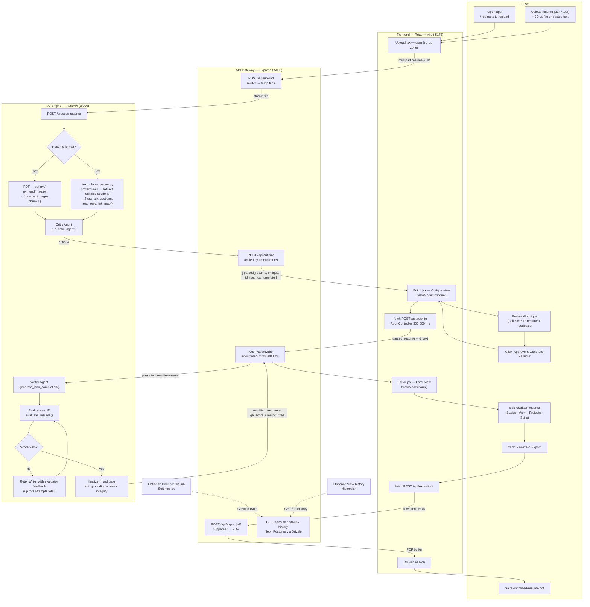

# Fuse — System-Level User Flow

> Swimlanes = the four layers a request passes through. Solid edges = the live end-to-end path. Dashed edges = optional/secondary flows. Decision diamonds = branching inside a service.

## Notes

- **The 5-minute timeouts are load-bearing.** The QA loop makes up to 3 slow Nvidia NIM (550B model) round-trips (Writer → evaluate → possibly retry). `G3` uses axios `timeout: 300000` and `F3` aborts at 300 000 ms. A `fetch` abort surfaces as `AbortError` in the UI ("rewrite took too long") — this is the *old* symptom of the QA loop getting stuck, not a normal state.
- **Anti-hallucination happens twice**: at prompt time (`prompt.py` constraints) and deterministically at `A10` (`validator.py` — `ground_resume_skills` strips ungrounded skills, `enforce_metrics_integrity` strips fabricated metric clauses). `_skills_grounding` is popped before the resume is returned to the client.
- **Export is JSON→puppeteer today.** `F5` always calls `/api/export/pdf`. A LaTeX-recompile path already exists end-to-end (`POST /api/compile` → `/api/compile-tex` → pdflatex, with a `%PDF-` magic-byte check) but the Editor UI is **not yet wired to it** — `U6` does not use it yet.
- **Failure paths**: missing resume/JD → 400 and the upload page stays put; Critic/Writer/evaluator LLM failure → 500 from the engine, surfaced by the gateway; invalid LaTeX → 422 forwarded from `/api/compile-tex`; gateway network failure → "Failed to rewrite resume".
- **Persistence** (`G5`): Neon PostgreSQL via Drizzle (`api-gateway/src/db/`). Used for GitHub OAuth tokens and saved history. Dashboard/History pages currently render mock data — not yet wired to `/api/history`.
